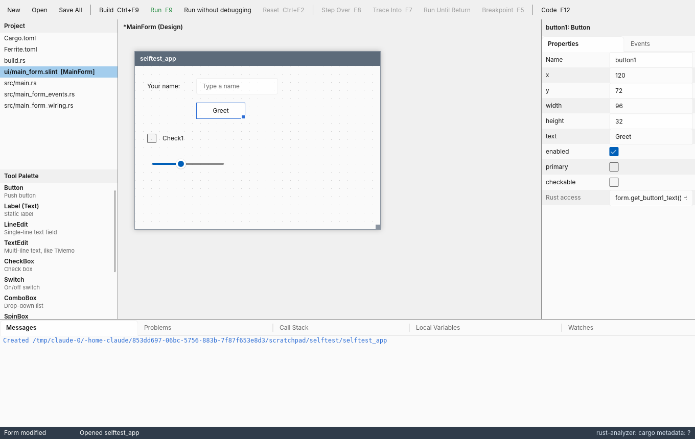
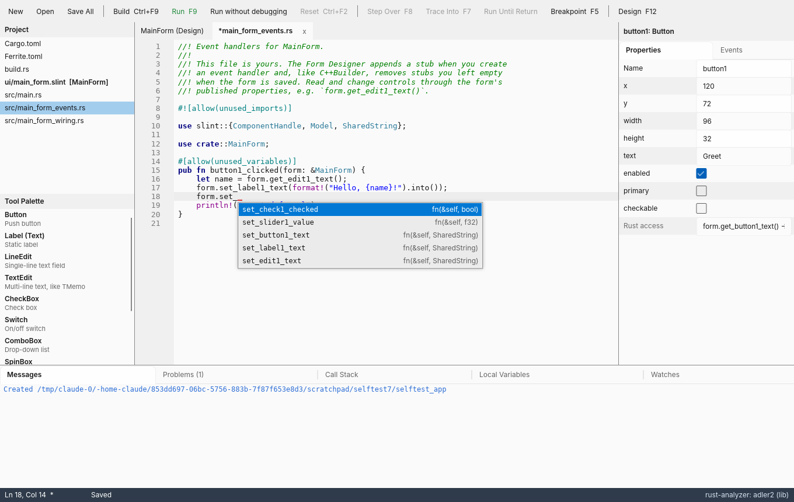
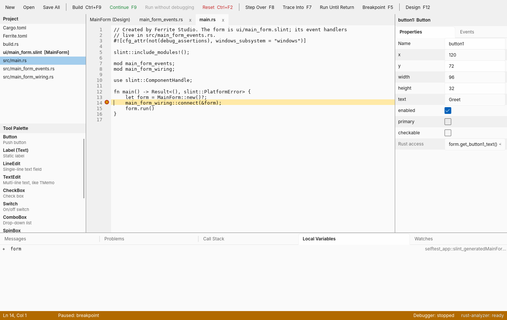
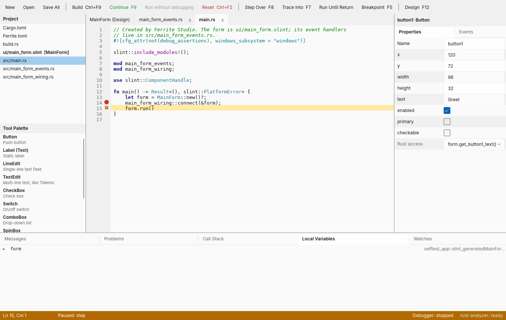
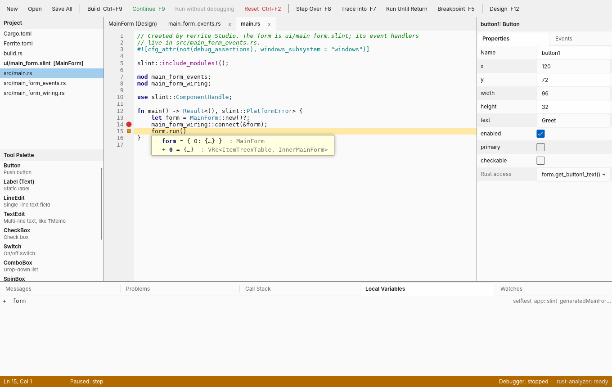

# Ferrite Studio

A RAD IDE for Rust:
drop controls on a form, set their properties in the Object Inspector,
double-click to write an event handler, press F9 to build and debug.

Forms are [Slint](https://slint.dev) `.slint` files, and the IDE is itself a
Slint application, so the designer draws your form with the same widgets
the finished program uses.

> Status: phase 0 prototype. Next: phase 1 (CodeLLDB on the MSVC toolchain,
> richer inspector editors, undo, multi-select), phase 2 (forms rendered by
> slint-interpreter, hand edits kept, a full code editor), phase 3 (several
> forms per app, refactoring, packaging).

| Form Designer and Object Inspector | Handler code with rust-analyzer completion |
| --- | --- |
|  |  |
| **Stopped at a breakpoint** | **After Step Over (F8)** |
|  |  |
| **Tooltip over a variable while paused** | |
|  | |

These screenshots are produced by `ferrite-studio --selftest`, which drives
the IDE through the whole session on its own.

## What works

| Area | Prototype |
| --- | --- |
| New Slint Application | Creates a cargo package with a form, `build.rs`, generated wiring and a handler file |
| Tool Palette | Button, Label (Text), LineEdit, TextEdit, CheckBox, Switch, ComboBox, SpinBox, Slider, ProgressIndicator, Panel (Rectangle) |
| Form Designer | Click a palette entry then the form to drop; drag to move; corner handle to resize; 8 px grid; Delete; Ctrl+arrows nudge |
| Object Inspector | Properties typed per control (text, numbers, booleans, colours, lists); Events tab |
| Event handlers | Double-click a control (or an event) to create `fn <control>_<event>(form: &MainForm, …)` and jump to it; empty handlers are pruned on save |
| Code editor | Monospace editor with syntax colouring (Rust, Slint, TOML), line numbers, auto-indent, error squiggles, breakpoints in the gutter |
| rust-analyzer | Live diagnostics, completion (Ctrl+Space, `.`, `::`; asked again once rust-analyzer has loaded the project), Help Insight (Ctrl+Shift+H), Find Declaration (Alt+Up), Format (Ctrl+D) |
| Build | Ctrl+F9 runs `cargo build`; errors land in Problems and jump to the source |
| Run / Debug | F9 builds and debugs; Shift+Ctrl+F9 runs without the debugger; Ctrl+F2 resets |
| Debugger | Breakpoints (F5), Step Over (F8), Trace Into (F7), Run Until Return (Shift+F8), Call Stack, Local Variables (double-click to expand), Watches (Ctrl+F5), tooltips over variables while paused (struct fields one level open, click to open more) |

## Requirements

* Rust 1.85 or newer, with rust-analyzer: `rustup component add rust-analyzer`
* A debug adapter, chosen automatically:
  * **GNU toolchains (Linux, MSYS2 on Windows):** GDB 14 or newer, used in its built-in DAP mode (`gdb -i=dap`)
  * **MSVC toolchain (rustup's Windows default) and macOS:** LLVM's `lldb-dap` on `PATH`, or in `C:\Program Files\LLVM\bin`
  * Or set `FERRITE_DAP` to any adapter command line that speaks DAP on stdio
* Linux builds need the usual Slint system libraries (fontconfig, xkbcommon).

## Build and run

```sh
cargo run --release            # opens the welcome page
cargo run --release -- path/to/project
```

The first build compiles Slint and takes a few minutes.

## How a project is laid out

```text
my_app/
  Cargo.toml                 slint 1.18 + slint-build
  Ferrite.toml               the forms and the files each one owns
  build.rs                   compiles ui/main_form.slint
  ui/main_form.slint         the form: written by the designer
  src/main.rs                creates MainForm, connects it, runs it
  src/main_form_wiring.rs    generated on save; do not edit
  src/main_form_events.rs    your handler code; the designer only appends stubs
```

Each control's main value is published on the form, so handlers read and
write controls through the form's getters and setters:

```rust
pub fn button1_clicked(form: &MainForm) {
    let name = form.get_edit1_text();
    form.set_label1_text(format!("Hello, {name}!").into());
}
```

The designer only reads the `.slint` subset it writes. A hand-edited form
that falls outside that subset opens in the code editor with the line that
stopped it; round-tripping hand edits arrives in phase 2.

## Workspace

| Crate | Purpose |
| --- | --- |
| `app` (ferrite-studio) | The IDE: Slint UI in `app/ui`, glue in `app/src` |
| `crates/ferrite-form` | Palette catalog, form model, `.slint` writer and reader, Rust code generation |
| `crates/ferrite-build` | Project templates, `Ferrite.toml`, cargo build/run with structured diagnostics |
| `crates/ferrite-rpc` | Content-Length framed JSON over child-process pipes |
| `crates/ferrite-lsp` | rust-analyzer client |
| `crates/ferrite-dap` | Debug Adapter Protocol client |

## Tests

```sh
cargo test --workspace
```

Besides unit tests, the suite compiles every palette control with Slint's
own compiler, drives a real rust-analyzer session, and runs a real
debug session (breakpoint, stack, locals, evaluate) when GDB 14+ or
lldb-dap is installed.

`ferrite-studio --selftest <folder>` scripts a whole IDE session (design,
handler, completion, build, breakpoint, step) and writes screenshots to the
folder.

## Licence

Ferrite Studio uses Slint, which is available under GPLv3, the Slint
Royalty-free Desktop License, or a commercial licence. Choose a licence for
this repository before distributing builds; see the design doc's risks
section.
